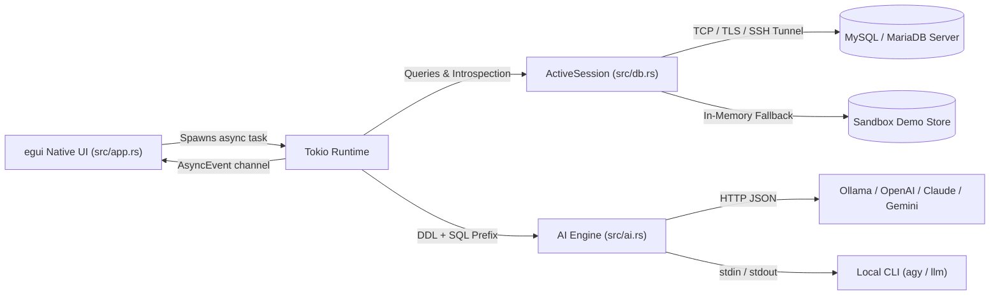

# MySQL-Rusty — Architecture & Step-by-Step Implementation Plan

> **Target Audience:** AI coding agents (including smaller/faster models) and developers continuing implementation of **MySQL-Rusty**, a modern 100% native Rust alternative to MySQL Workbench for Ubuntu Linux with deep AI autocomplete and CLI assistant integration.

---

## 1. System Overview & Current Baseline

**MySQL-Rusty** is a native Linux desktop GUI application written in Rust (`edition = "2024"`) using:
- **GUI Framework:** `eframe` / `egui` (`0.37`) + `egui_extras` (`TableBuilder` for high-density virtualized result grids) with the `glow` (OpenGL) backend on X11 and Wayland. No WebView or browser runtime is used.
- **Database Engine:** `mysql_async` (`0.37`) over `tokio` (`1.43`) with Rustls TLS support and OpenSSH (`ssh -N -L`) subprocess tunneling.
- **AI Engine:** Multi-provider HTTP & CLI client (`reqwest` + `tokio::process::Command`) supporting:
  1. **Ollama** (Local models like `qwen2.5-coder:7b`, `codestral`, `llama3.2`)
  2. **OpenAI-Compatible APIs** (OpenAI, Groq, OpenRouter, vLLM, DeepSeek)
  3. **Anthropic API** (Claude)
  4. **Google Gemini API**
  5. **Local CLI Tool** (`agy`, `llm`, `claude`, or any CLI accepting prompts via `stdin` or CLI argument)

### Current Directory Structure

```text
mysql-rusty/
├── Cargo.toml                  # Dependencies & build configuration
├── ARCHITECTURE_AND_PLAN.md    # This step-by-step developer & agent roadmap
├── README.md                   # Quickstart, build instructions, and keyboard shortcuts
└── src/
    ├── main.rs                 # Entrypoint, Tokio runtime setup, and unit tests
    ├── config.rs               # Persistent JSON config (~/.config/mysql-rusty/config.json)
    ├── db.rs                   # Async MySQL/MariaDB driver, SSH tunnel, schema introspection, Sandbox mode
    ├── syntax.rs               # SQL lexer, syntax highlighter, formatter, and ghost-text layouter
    ├── ai.rs                   # Schema-aware local autocomplete + LLM/CLI inline & chat engine
    ├── export.rs               # CSV, JSON, and SQL INSERT exporters
    └── app.rs                  # Main eframe::App state machine, panels, modals, and async event loop
```

### Golden Rules for Any Model Modifying This Repository
1. **Language:** Keep 100% of code, comments, UI labels, error messages, and documentation in **English**.
2. **Non-Blocking UI Thread:** Never run network I/O, database queries, or CLI commands synchronously inside `eframe::App::update`. Always spawn tasks on `self.rt` (`Arc<tokio::runtime::Runtime>`) and send results back over `self.tx` (`UnboundedSender<AsyncEvent>`).
3. **Verification After Every Task:** Run `cargo check` and `cargo test` after every single change before moving to the next phase.

---

## 2. Architecture Data Flow



---

## 3. Step-by-Step Implementation Roadmap (For Next Agent Runs)

Each phase below is self-contained and ordered by priority. Follow the instructions, target files, and verification steps in order.

---

### Phase 1: Cursor-Aware Multi-Statement Execution & Debounced AI Ghost Text
**Objective:** Right now, pressing `Ctrl+Enter` runs the entire active tab buffer, and AI inline completion is triggered via `Ctrl+Space` or local heuristics. Upgrade the editor to detect the statement under the cursor (delimited by `;`) and automatically debounce LLM ghost-text requests when typing stops.

#### Tasks:
1. **Statement-Under-Cursor Extraction (`src/syntax.rs`):**
   - Add `pub fn extract_statement_at_cursor(sql: &str, cursor_char_idx: usize) -> (String, (usize, usize))` that splits statements by `;` (ignoring `;` inside single/double quotes or comments) and returns the statement containing `cursor_char_idx`.
2. **Track Cursor Position & Selection (`src/app.rs`):**
   - In `QueryTab`, add `pub cursor_index: usize`, `pub selected_sql: Option<String>`, and `pub last_edit_instant: Option<std::time::Instant>`.
   - In `MysqlRustyApp::render_central_workspace`, read `editor_resp.state.cursor.char_range()` from `egui::TextEdit::multiline` output.
   - If the user has highlighted a selection, `▶ Run (Ctrl+Enter)` executes only the selected text; otherwise, add a button `▶ Run Current Statement (Ctrl+Shift+Enter)` using `extract_statement_at_cursor`.
3. **Debounced Automatic Inline AI Completion (`src/app.rs`):**
   - When `self.config.ai.enable_inline_autocomplete` is `true` and `tab.last_edit_instant` is older than `450ms` without a pending request, automatically call `self.trigger_inline_ai_completion()` for the text up to `tab.cursor_index`.
4. **Verification:**
   - Add unit tests in `src/main.rs` testing `extract_statement_at_cursor` with multi-statement SQL strings containing quoted semicolons.
   - Run `cargo test`.

---

### Phase 2: Full Table Designer & Visual DDL Builder (Create / Alter Table)
**Objective:** Give users a MySQL Workbench-style visual editor to create new tables or alter existing columns, indexes, and foreign keys without writing `ALTER TABLE` manually.

#### Tasks:
1. **Create New Module `src/table_designer.rs`:**
   - Define `pub struct TableDraft` containing:
     - `original_table: Option<TableSchema>` (if `None`, mode is `CREATE TABLE`; if `Some`, mode is `ALTER TABLE`)
     - `table_name: String`, `engine: String`, `charset: String`
     - `columns: Vec<ColumnInfo>`, `foreign_keys: Vec<ForeignKeyInfo>`, `indexes: Vec<IndexInfo>`
   - Implement `pub fn generate_ddl_diff(&self) -> String`:
     - When `original_table.is_none()`, generate a formatted `CREATE TABLE` statement with `PRIMARY KEY`, `KEY`, and `CONSTRAINT ... FOREIGN KEY`.
     - When `original_table.is_some()`, compare old vs. new columns/indexes and generate `ALTER TABLE ... ADD COLUMN / MODIFY COLUMN / DROP COLUMN` statements.
2. **Integrate into UI (`src/app.rs`):**
   - Add a `🛠 Design Table` button next to `SELECT *` and `DDL` in `render_schema_tree` (`src/app.rs`), plus a `➕ New Table` button at the top of the Schema Explorer.
   - Render a live DDL preview at the bottom of the Table Designer with `▶ Apply DDL` and `📋 Open in Query Tab` buttons.
3. **Verification:**
   - Add unit tests verifying `TableDraft::generate_ddl_diff()` output for both `CREATE TABLE` and `ALTER TABLE`.
   - Run `cargo test`.

---

### Phase 3: Interactive 2D Canvas Entity-Relationship (ER) Diagram
**Objective:** Upgrade the current card-based `BottomTab::ErRelationships` view into an interactive pan-and-zoom 2D canvas with cubic Bézier curves connecting Foreign Key columns to Primary Key columns.

#### Tasks:
1. **Create New Module `src/er_diagram.rs`:**
   - Define `pub struct ErCanvasState`:
     - `pan_offset: egui::Vec2`
     - `zoom: f32`
     - `node_positions: HashMap<String, egui::Pos2>` (auto-laid out in a grid when first initialized for a database)
   - Render each `TableSchema` as a draggable node box using `egui::Painter` inside `ui.allocate_painter(ui.available_size(), egui::Sense::click_and_drag())`.
   - For each `ForeignKeyInfo` in `table.foreign_keys`, compute the screen coordinates of the source column row and target table column row, and draw a cubic Bézier curve (`egui::epaint::CubicBezierShape`) with an arrowhead and highlight on hover.
2. **Wire into `BottomTab::ErRelationships` (`src/app.rs`):**
   - Replace `render_er_relationships` with `ErCanvasState::show(ui, schema)` and add an `Auto-Layout` button and `Reset Zoom` button.
3. **Verification:**
   - Run `cargo check` and `cargo test`.

---

### Phase 4: Server Administration, Process List & Query Cancellation
**Objective:** Provide MySQL Workbench's Server Administration capabilities: live `SHOW PROCESSLIST`, killing stuck queries, server variables inspector, and cancelling a long-running query from a tab.

#### Tasks:
1. **Database Methods (`src/db.rs`):**
   - Add `pub async fn list_processes(&self) -> Result<QueryResult>` executing `SHOW FULL PROCESSLIST` (and returning mock processes in `DemoSandbox`).
   - Add `pub async fn kill_query(&self, connection_id: u64) -> Result<()>` executing `KILL QUERY <id>`.
   - Add `pub async fn server_status_summary(&self) -> Result<HashMap<String, String>>` querying `SHOW GLOBAL STATUS` for `Uptime`, `Threads_connected`, `Questions`, `Slow_queries`, `Innodb_buffer_pool_bytes_data`.
2. **UI Tab (`src/app.rs`):**
   - Add `BottomTab::ServerAdmin` ("🖥 Server Monitor") displaying metric cards (Uptime, Active Connections, Queries/sec, Slow Queries) and the live Process List table with a `🛑 Kill Query` button on each row.
   - Add a `⏹ Stop` button next to `▶ Run` when `tab.is_running == true` that aborts the spawned Tokio task handle.
3. **Verification:**
   - Run `cargo test`.

---

### Phase 5: Security Hardening (OS Keyring Integration) & Data Import Wizard
**Objective:** Store database passwords and AI API keys in the Ubuntu Secret Service / GNOME Keyring instead of plain text in `config.json`, and allow importing CSV/JSON files into any table.

#### Tasks:
1. **OS Keyring (`src/config.rs`):**
   - Add optional crate `keyring` or `secret-service` fallback so passwords and API keys are stored under service `"mysql-rusty"` in Ubuntu's native keyring, keeping `config.json` free of secrets.
2. **CSV / JSON Table Import Wizard (`src/export.rs` & `src/app.rs`):**
   - Add `pub fn parse_csv_to_batch_insert(table: &str, csv_content: &str) -> Result<String>` in `src/export.rs`.
   - Add an `📥 Import CSV` button in the Schema Explorer table actions.
3. **Verification:**
   - Add unit tests for `parse_csv_to_batch_insert` and run `cargo test`.
